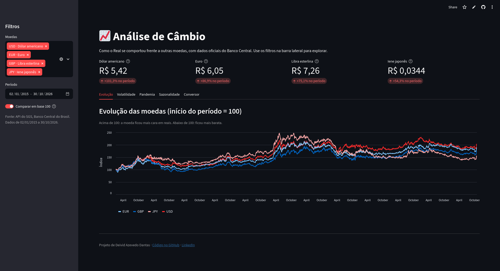

# 📈 Análise de Câmbio: o Real frente a outras moedas (2015–2026)


Projeto de análise de dados que **coleta, trata e analisa** quase 3 mil dias de cotações do Real brasileiro frente a quatro moedas, usando dados oficiais do **Banco Central do Brasil**.

> Projeto complementar ao [Banco Multimoedas](https://github.com/deividazevedo292-coder/banco-multimoedas), meu sistema bancário em Python com PostgreSQL. Lá eu converto valores; aqui eu analiso como essas moedas se comportaram ao longo dos anos.

### 🔗 [Abrir o dashboard online](https://dashboard-cambio-deivid.streamlit.app)

[](https://dashboard-cambio-deivid.streamlit.app)

---

## 💡 Principais resultados

| Pergunta | Resposta |
| --- | --- |
| Qual moeda mais se valorizou frente ao Real desde 2015? | **Dólar: +101%** (de R$ 2,69 para cerca de R$ 5,42). Depois: euro +87%, libra +75%, iene +54% |
| Qual moeda foi a mais volátil? | Todas parecidas, **cerca de 15% ao ano**, com o iene levemente acima. Os anos mais instáveis foram 2015 e 2020 |
| Como o Real reagiu à pandemia? | O dólar foi de R$ 4,50 (fim de fev/2020) para **R$ 5,94 em 14/05/2020: alta de 32% em menos de 3 meses** |
| Existe um "mês certo" para comprar dólar? | **Não.** Agosto parece subir mais (+3% em média), mas a média é puxada por 3 anos atípicos. Com 11 anos de dados, não há padrão confiável |

**Em resumo:** entre 2015 e 2026 o Real perdeu valor frente a todas as moedas analisadas, e a instabilidade do câmbio se concentrou em momentos de crise.

---

## 📊 Dashboard

O dashboard interativo em Streamlit tem:

- Filtros por moeda e período
- Indicadores principais
- Gráficos de evolução, volatilidade, pandemia e sazonalidade
- Conversor com a última cotação disponível

---

## 🗂️ Dados

| Moeda | Código | Série no SGS (Banco Central) |
|---|---|---|
| Dólar americano | USD | 1 |
| Euro | EUR | 21619 |
| Libra esterlina | GBP | 21623 |
| Iene japonês | JPY | 21621 |

- **Fonte:** API pública do SGS (Sistema Gerenciador de Séries Temporais) do Banco Central
- **Período:** janeiro de 2015 até a data da coleta
- **Frequência:** diária (dias úteis)
- **Valor:** cotação de venda, em reais

---

## 🔍 Como a análise foi feita

- **Coleta em blocos:** a API limita séries diárias a janelas de no máximo 10 anos, então o `coleta.py` busca os dados em blocos de 3 anos e junta tudo no final
- **Tratamento sem inventar dados:** feriados e dias sem cotação ficam de fora; cada moeda é analisada só com os dias em que tem dados
- **Base 100:** como o iene vale centavos e a libra mais de R$ 7, todas as moedas são comparadas a partir do mesmo ponto inicial
- **Volatilidade anualizada:** desvio padrão das variações diárias, multiplicado pela raiz de 252 (dias úteis no ano)
- **Validação dos dados:** o peso argentino chegou a ser incluído, mas a checagem mostrou que a série usada (21637) era um indicador mensal, e não a cotação diária. Por isso ele foi retirado da análise

---

## ▶️ Como executar

```bash
# 1. instalar as dependências
pip install -r requirements.txt

# 2. coletar os dados (salva em data/cotacoes.csv)
python coleta.py

# 3. abrir o dashboard interativo
streamlit run dashboard.py
```

Para ver a análise completa, abra o `analise.ipynb` no Jupyter ou no VS Code e execute todas as células.

---

## 📁 Estrutura do projeto

```
analise-cambio/
├── coleta.py          # coleta das cotações na API do Banco Central
├── data/
│   └── cotacoes.csv   # dados coletados
├── analise.ipynb      # análise exploratória e conclusões
├── dashboard.py       # dashboard interativo em Streamlit
├── requirements.txt   # dependências do projeto
└── README.md
```

---

## 🛠️ Tecnologias

- Python
- pandas
- requests
- matplotlib
- Streamlit
- Jupyter Notebook

---

## 🚧 Status

- [x] Coleta automatizada dos dados via API
- [x] Limpeza e tratamento
- [x] Análise exploratória
- [x] Visualizações
- [x] Conclusões
- [x] Dashboard interativo

---

## 👤 Autor

**Deivid Azevedo Dantas** — estudante de Análise e Desenvolvimento de Sistemas no Centro Universitário FMU

[](https://www.linkedin.com/in/deivid-azevedo-4b5709344/)
[![Portfólio](https://deividazevedo292-coder.github.io/
